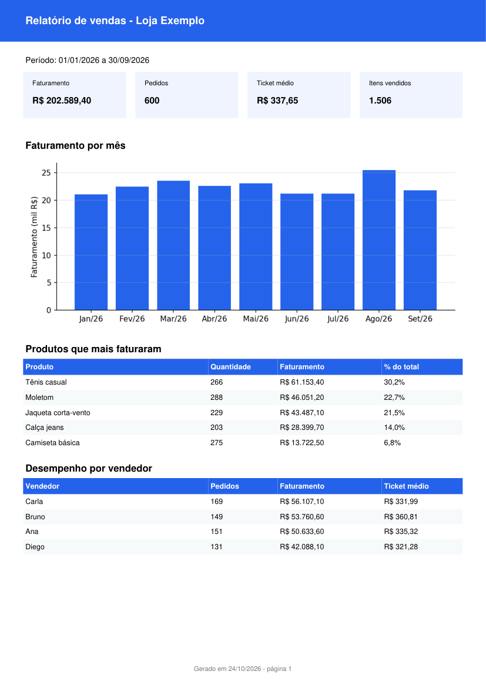

# Relatório de vendas em PDF a partir de planilha

Transforma uma planilha de vendas (Excel ou CSV) em um relatório PDF pronto para enviar ao dono do negócio: faturamento, ticket médio, gráfico mensal, produtos que mais vendem e desempenho por vendedor.



**Problema que resolve:** muita loja ainda monta relatório na mão, copiando dados do Excel todo fim de mês. Este script faz isso em segundos e pode rodar automaticamente.

## Como usar

Requer Python 3.10 ou mais novo.

```bash
python -m venv .venv
source .venv/bin/activate        # no Windows: .venv\Scripts\activate
pip install -r requirements.txt

python gerar_dados_exemplo.py    # cria dados/vendas_exemplo.xlsx
python gerar_relatorio.py dados/vendas_exemplo.xlsx --empresa "Loja Exemplo" --previa
```

O relatório é salvo em `saida/relatorio.pdf`. Com `--previa`, a primeira página também vira uma imagem em `saida/relatorio.png`, boa para mandar por WhatsApp. Para salvar em outro lugar, use `-o`, por exemplo `-o relatorios/marco.pdf`.

A pasta `exemplo/` traz um relatório já pronto ([PDF](exemplo/relatorio_exemplo.pdf) e imagem), para quem visita o repositório ver o resultado sem rodar nada. Ele foi gerado com:

```bash
python gerar_relatorio.py dados/vendas_exemplo.xlsx -o exemplo/relatorio_exemplo.pdf --empresa "Loja Exemplo" --previa
```

## Formato da planilha

| data | produto | vendedor | quantidade | preco_unitario |
|---|---|---|---|---|
| 05/01/2026 | Camiseta básica | Ana | 2 | 49.90 |

Outras colunas são ignoradas. Os nomes das colunas não diferenciam maiúsculas de minúsculas.

## Estrutura

| Arquivo | O que faz |
|---|---|
| `gerar_relatorio.py` | Lê a planilha, calcula os indicadores, desenha o gráfico, monta o PDF e a imagem de prévia |
| `gerar_dados_exemplo.py` | Cria uma planilha fictícia com 600 vendas para testar |
| `exemplo/` | Um relatório já gerado, em PDF e PNG |
| `saida/` | Onde ficam os relatórios que você gerar (fica fora do Git) |
| `tests/` | Testes com pytest |

## Testes

```bash
pytest
```

## Tecnologias

Python, pandas, matplotlib, fpdf2, PyMuPDF.

## Ideias de evolução

- Enviar o PDF por e-mail ou WhatsApp automaticamente todo dia 1º.
- Ler direto do Google Sheets ou do banco de dados do sistema da loja.
- Comparar com o mês anterior e destacar quedas.

## Autor

Feito por **Luis Lopo**, desenvolvedor Python, Java e TypeScript. Faço automações, relatórios e chatbots sob medida para pequenos negócios. Veja os outros projetos no meu perfil do GitHub.